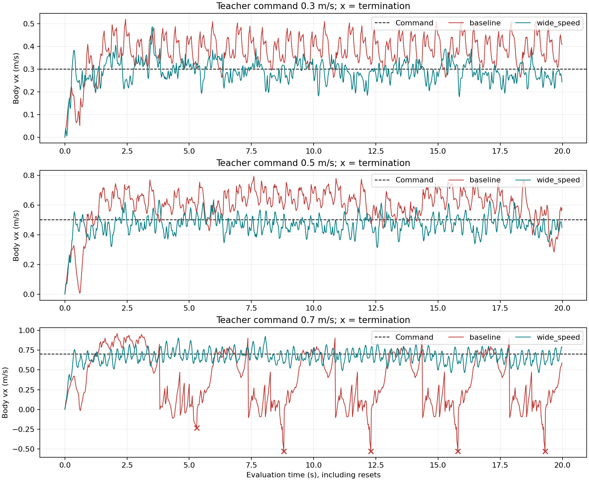
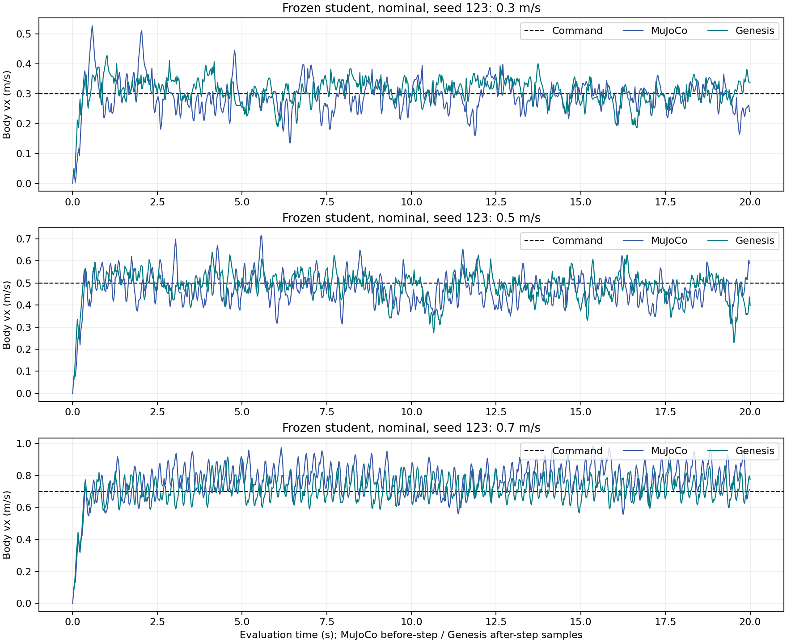
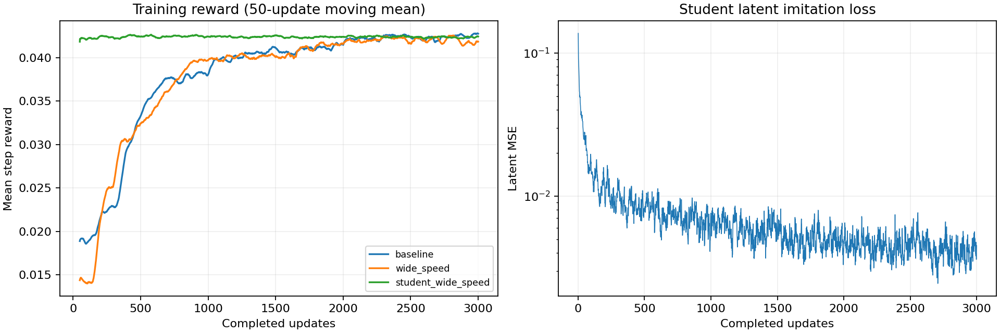

# EXP-010 归档：扩大训练速度覆盖

实验问题、命令、结论和局限见 [实验记录](../../../experiments/rma/EXP-010_forward_speed_coverage.md)。

本目录来自 `/home/abc/my_unilab/runs/rma/EXP-010/20261027_160750`，包含 34 次已完成评估：教师 nominal 18 次、学生 nominal 3 次、学生随机化 3 次、Genesis 9 次、TensorRT 1 次。模型和原始运行目录保留本地。

## 阅读顺序

1. 看实验记录：本轮只把教师速度采样上限从 0.6 扩到 0.8 m/s。
2. 看 `metrics.csv`：每一行代表一次完整回放；终止、截断分开计数。
3. 看三张图：训练过程、教师对照、学生跨引擎表现。
4. 看 `summary.json` 与压缩轨迹：核对每次报告和逐步数据。
5. 看 `manifest.json`：定位本地模型、原始文件及 SHA256。

| 内容 | 作用 |
| --- | --- |
| [metrics.csv](metrics.csv) | 从 CSV 重算的速度、平面 RMSE、偏航、异常终止与时间截断 |
| [summary.json](summary.json) | 34 次评估的完整摘要和评估参数 |
| [manifest.json](manifest.json) | 每个归档输入的原路径、大小、SHA256，以及未复制模型的哈希 |
| `training/` | baseline、wide_speed、student 的 3000 次更新指标与运行参数 |
| `evaluations/` | MuJoCo 的 summary、run_configuration、评估当时任务快照和 transitions.csv.gz |
| `genesis/` | 九次逐步 CSV.gz 和输出文本；1.3.3 GPU、substeps=2 |
| `deployment/` | TensorRT 构建、闭环评估、ONNX 元数据、10 秒 C++ mock 输出 |
| `source_at_archive/` | 归档时的脚本、算法和配置副本；不是训练时的版本证明 |

归档内将 `run_config.json` 重命名为 `run_configuration.json`，便于提交而不受仓库运行产物忽略规则影响。压缩轨迹解压后的字节 SHA256 与原文件一致。

## 关键图

教师图只展示 seed 123，其余两个 nominal seed 的数值相同；叉号为异常终止，横轴使用全局 evaluation step，不随 reset 归零。

学生图展示 seed 123。MuJoCo 使用 step 前速度，Genesis 使用 step 后速度，不能逐点要求相等。Genesis 其余种子与统计见 metrics.csv。

训练 reward 为 50 次更新移动平均，latent MSE 为原始逐次值。两组指令分布不同；学生又使用预训练冻结教师，不能仅据训练 reward 高低判断优劣。

## 结果应该如何表述

在本次一个训练种子的对照中，wide_speed 教师在 0.7 m/s 下的异常终止由每次 5 次降为 0 次，平面 RMSE 从 0.5249 降为 0.1130 m/s。学生在随机化的三个 0.7 m/s 样本中无异常终止，但平均速度仅 0.584–0.656 m/s。Genesis nominal 九次回放均无姿态终止。

这支持当前配置继续作为验证基线。它不能证明多训练种子都有效，不能证明对任意负载/摩擦/地形鲁棒，也不能证明真机安全或硬实时。episode 提前结束需要检查 terminated/truncated，不能单凭长度判断摔倒。

## 重建归档

使用 [archive_exp010.py](../../../scripts/archive_exp010.py)，命令见实验记录。脚本读取本次明确时间戳会话，拒绝覆盖现有输出，并核对完整回放数、有限数值、逐步 RMSE 与原报告一致性；不会重新训练或启动仿真。

归档脚本依赖 NumPy、Matplotlib。当前记录还存在训练时 Git revision 缺失、历史训练配置未独立快照的限制，当前源码快照不能补造这些证据。
