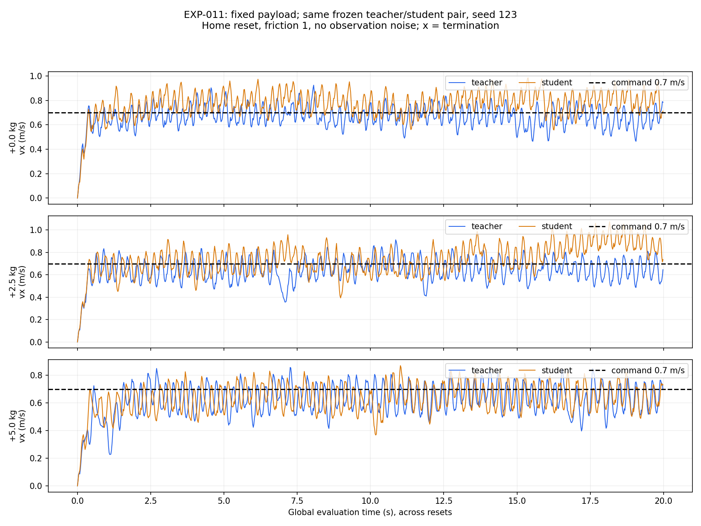

# EXP-011：固定负载诊断证据

完整协议、假设、命令和结论见 [实验记录](../../../experiments/rma/EXP-011_payload_diagnosis.md)。
本目录只收录固定 seed 123 的六次 1000 步回放，没有新训练。

| 文件 | 内容 |
| --- | --- |
| [metrics.csv](metrics.csv) | 六组全程/后段速度、RMSE、终止与动作边界占比 |
| [summary.json](summary.json) | 汇总及实验参数 |
| [protocol.json](protocol.json) | 同一学生 checkpoint、种子、指令和运行源码哈希 |
| [manifest.json](manifest.json) | 所有输入来源及 SHA256；checkpoint 不复制 |
| `evaluations/` | 原始报告、运行参数、任务快照、压缩逐步 CSV、日志文本 |
| `source_at_evaluation/` | 与运行前记录哈希一致的配置和入口源码 |
| `source_at_archive/` | 归档时保存的编排/分析脚本，单独标注来源时间边界 |

六次没有异常终止，均在 1000 步超时。5 kg 时 teacher/student 全程均速约 0.622/0.629 m/s，零负载学生约 0.769 m/s。
负载敏感性足以解释一部分速度变化；本轮没有证明它解释所有随机化欠速，也没有证明学生模仿误差是唯一根因。
移除每回合前 100 步后，每组保留 900 行，六组均满足实验预定的后段筛查阈值；全程指标仍完整保留。

动作边界占比指归一化 action 的绝对值至少 0.95，不是电机扭矩饱和比例。
当前维持 `[0.3, 0.8]` 训练范围与 scale=0.25，后续先单独检查 PD 增益条件。

原始运行目录为 `/home/abc/my_unilab/runs/rma/EXP-011/payload_screen_20261027_2232`。
模型、虚拟环境、资产和大文件保留本地；本证据不构成真机或全仓运行兼容性认证。
