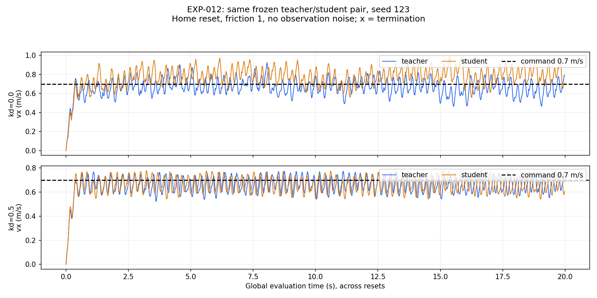

# EXP-012：主动阻尼诊断证据

同一冻结模型、0.7 m/s 指令、零附加质量，只比较主动 kd=0 与 0.5。
每格为 1 环境 × 1000 控制步（20 s），seed 123，无观测噪声。

| kd | 策略 | 全程平均 vx | 全程平面 RMSE | 去启动段平均 vx | 去启动段平面 RMSE | 异常终止 |
| --- | --- | ---: | ---: | ---: | ---: | ---: |
| 0 | teacher | 0.66436 | 0.11297 | 0.67425 | 0.09783 | 0 |
| 0 | student | 0.76871 | 0.14149 | 0.78458 | 0.13164 | 0 |
| 0.5 | teacher | 0.65628 | 0.09660 | 0.66217 | 0.07934 | 0 |
| 0.5 | student | 0.65612 | 0.09611 | 0.66226 | 0.07921 | 0 |

单位均为 m/s。去启动段是每回合前 100 步之后，每格 900 个样本。
四格均满足预先设定筛查阈值；不表示精确跟踪或全面鲁棒。

上下两图纵轴范围不同，不能直接以像素振幅比较。数值比较用 [metrics.csv](metrics.csv)。
学生与教师动作 RMSE 从 0.08537 降到 0.01340，latent MSE 从 0.10131 降到 0.00386；
这些是各自闭环轨迹上的比较，不是同一批离线观测的配对误差。
固定条件中的主动增益会改变表现，但尚未隔离所有随机化因素，也没有完成跨引擎复验。

- [实验设计、结果和学习任务](../../../experiments/rma/EXP-012_damping_diagnosis.md)
- [协议与模型/源码哈希](protocol.json)
- [汇总](summary.json)；[原始证据清单](manifest.json)
- `evaluations/`：四份逐步 CSV（gzip）、summary、解析配置与日志。
- `source_at_evaluation/`：运行时记录哈希的实际源码；`source_at_archive/`：单独标记的归档入口。

原始运行：`/home/abc/my_unilab/runs/rma/EXP-012/damping_screen_20261027_2304`。
checkpoint SHA256：`28785b298e5071d109ace124dc1c3388e2324fb8c5fda29087cfb829049ce5c5`。
本目录保存 76 份输入的哈希；权重、环境、3D 资产不提交。
这是一个确定性种子的条件筛查，未训练新模型；不能把重复运行当成多训练种子统计。
