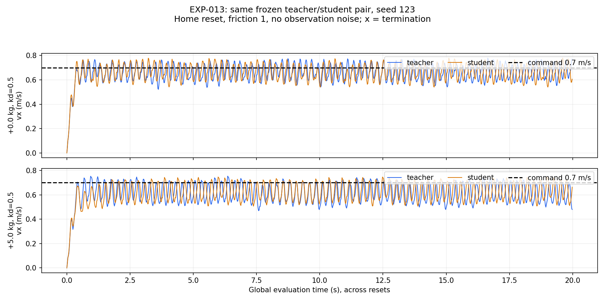

# EXP-013：固定 kd=0.5 的负载对照证据

日期：2026-10-28。固定同一模型、kp=35、kd=0.5、摩擦=1、指令 0.7/0/0、无噪声与 home reset。
唯一变量是附加机身质量 0/5 kg；每格 1 环境 × 1000 步，seed 123，20 秒。

| 附加质量 | 策略 | 全程平均 vx | 全程平面 RMSE | 去启动段平均 vx | 去启动段平面 RMSE | 异常终止 |
| --- | --- | ---: | ---: | ---: | ---: | ---: |
| 0 kg | teacher | 0.65628 | 0.09660 | 0.66217 | 0.07934 | 0 |
| 0 kg | student | 0.65612 | 0.09611 | 0.66226 | 0.07921 | 0 |
| 5 kg | teacher | 0.60930 | 0.13837 | 0.61438 | 0.12531 | 0 |
| 5 kg | student | 0.61697 | 0.13325 | 0.62647 | 0.11639 | 0 |

速度和 RMSE 的单位都是 m/s；后段剔除每回合前 100 步，每格剩余 900 行。
四组均在 1000 步超时，均符合预先沿用的宽松筛查阈值，但负载组存在系统性欠速，不能称精确跟踪。

## 能支持什么

在这一固定条件下，5 kg 仍使教师/学生全程平均速度分别下降约 0.0470/0.0392 m/s，平面 RMSE 都增大。
教师也受影响，因此不能只责怪学生的适应网络。5 kg 学生相对教师 action RMSE=0.02714、latent MSE=0.00882；
它们是该学生轨迹上的模仿指标，不是负载估计的物理单位误差，也不是任务成功的充分条件。
本次没有观察到异常终止；欠速不需要由摔倒解释。

EXP-011 的 kd=0、5 kg 全程平均速度为 teacher 0.62195/student 0.62905；
改为 kd=0.5 并没有使其更快，尽管平面 RMSE 较低。速度偏差和波动要分别判断。
这不是关于所有负载、初始条件、指令或真机增益的结论。

## 数据入口与复现边界

- [设计与结论](../../../experiments/rma/EXP-013_payload_at_fixed_kd.md)
- [逐格指标](metrics.csv)、[汇总](summary.json)、[运行协议](protocol.json)、[81 份输入哈希](manifest.json)
- `evaluations/`：四组逐步 CSV（gzip）、summary、运行配置、任务 YAML 快照与日志。
- `source_at_evaluation/`：运行协议记录哈希的源码；薄 runner 的归档副本另标为 `source_at_archive/`。

原始运行：`/home/abc/my_unilab/runs/rma/EXP-013/payload_at_kd_20261028_1235`。
模型 SHA256：`28785b298e5071d109ace124dc1c3388e2324fb8c5fda29087cfb829049ce5c5`。
零负载两格与 EXP-012 同条件重现；仅同步本轮文件，未修改权重、虚拟环境或训练默认配置。
同一个确定性种子的复测不是多训练种子或多物理初始条件的鲁棒性证明。
附加质量沿用训练事件、不重算惯量；本轮没有证实扭矩饱和、足端打滑或其唯一机制。
