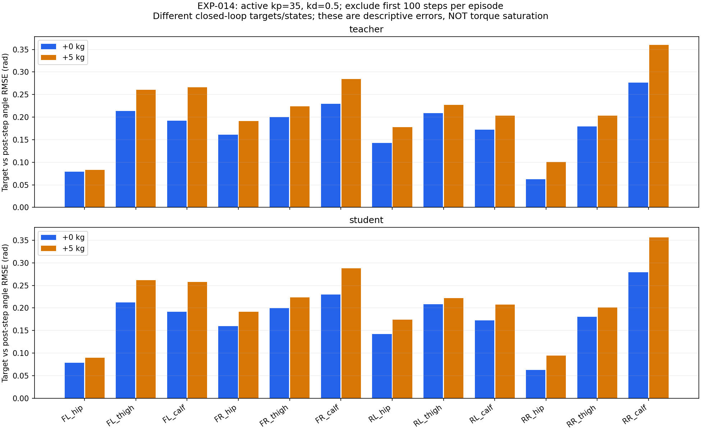

# EXP-014：关节目标与实际角度在哪里看

2026-10-28。保持 EXP-013 同一冻结模型、指令 0.7/0/0、配置 kp=35/kd=0.5、摩擦 1、0/5 kg、home reset、无噪声。
每格 1000 步，seed 123。新增记录 48000 行逐关节信号；四组 transitions 与 EXP-013 按 CSV 字段逐行完全一致。
新增记录没有改变原回放动作、速度、奖励、终止或 reset；这仍不是多条件鲁棒性证明。

## 先打开这些图

- [学生，0 kg，12 关节曲线](evaluations/kd_0p5_student/control_tracking.png)
- [学生，5 kg，12 关节曲线](evaluations/kd_0p5_payload_5_student/control_tracking.png)
- [教师，0 kg，12 关节曲线](evaluations/kd_0p5_teacher/control_tracking.png)
- [教师，5 kg，12 关节曲线](evaluations/kd_0p5_payload_5_teacher/control_tracking.png)
- [负载前后误差柱状图](joint_tracking_rmse.png)；[48 行逐关节指标](metrics.csv)

曲线蓝色为权威控制缓冲实际写入的目标角度，橙色为该动作执行一个控制步后测得的关节角度。
横轴秒、纵轴弧度。四行 FL/FR/RL/RR 对应前左/前右/后左/后右；三列 hip/thigh/calf。
这里的目标是绝对关节目标，不是原始 action。负载间的曲线纵轴可能自动缩放，用柱状图/指标作定量比较。
没有证据表明每个控制步结束时橙线都应该追上移动的蓝线，二者有间距不自动意味着故障。

## 当前数据支持什么

所有控制映射残差都是 0；动作处理目标到控制缓冲的排列在本次回放一致。
各关节去除每回合前 100 步后各剩 900 行，负载后两条策略的 12 个关节目标/步后实际角度 RMSE 都增大。
增幅最明显的是 RR_calf：teacher 0.27666→0.36021 rad，student 0.27930→0.35637 rad。
FL_calf、FR_calf 等也增大。它提示受载时闭环目标/响应差距变化，值得继续调查。
因为策略目标与状态分布也随负载改变，不能仅凭该 RMSE 宣称执行器能力不足，更不能直接提高 kp 或 scale。

## 增益读取的实际限制

初次冒烟中，配置 kd=0.5，但公共 `get_actuator_gains()` 返回参考模型 kd=0。
已安装 UniSim MuJoCo 实现从 `_model.actuator_*prm` 读取基础模型；reset 写入通过批量环境的模型字段另行提交。
因此这不是每环境 reset 增益的权威读回，不能拿它证明 kd 没有生效，也不能冒充实际增益已测量。
本轮保留并分别标记：`kp/kd` 为受控配置值，`gain_source=configured_evaluation_condition`；
`backend_reference_kp/kd` 为该公共接口读数。没有修改依赖、后端私有字段或训练行为。
`pd_demand_estimate_nm` 只按配置值在控制边界代数估算；不是实测扭矩，不用于宣称力矩饱和。
此前 EXP-012/013 的速度差异仍是实测事实，但参数名称不替代实际读回验证。

## 可复查数据

- [运行协议及源码哈希](protocol.json)、[103 份输入哈希](manifest.json)、[诊断设计](../../../experiments/rma/EXP-014_joint_tracking.md)
- 每组 `control_signals.csv.gz`：逐步逐关节目标/实际角度/速度/映射残差/估算 PD 项/来源标记。
- 每组 `transitions.csv.gz`：与 EXP-013 对齐的速度、动作、奖励和实际摩擦/负载标签。
- 每组 `control_summary.json`、`control_metadata.json`、`diagnostic_summary.json` 和解析配置快照。

原始目录：`/home/abc/my_unilab/runs/rma/EXP-014/joint_tracking_20261028_1310`。
本轮仅诊断，不训练、不重新导出，也没有证明唯一物理根因。
