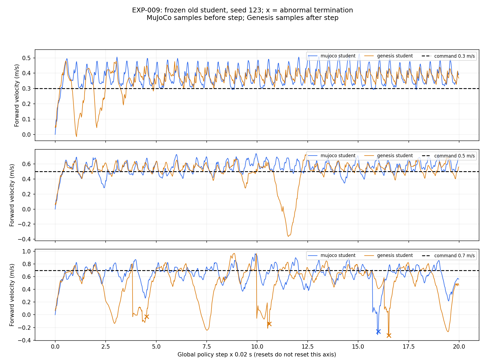

# EXP-009：旧策略速度扫描归档

问题、协议、结论见 [实验记录](../../../../experiments/rma/EXP-009_speed_generalization.md)。

本目录包含 13 次历史评估：Genesis 1.3.3 GPU 九次、MuJoCo student 三次、MuJoCo teacher 一次。
没有重新训练或运行物理仿真，没有混入 Genesis 1.4.5 / CPU 的重试数据。

| 文件 | 用途 |
| --- | --- |
| [metrics.csv](metrics.csv) | 从 13 份逐步 CSV 重算的速度、平面 RMSE、异常和超时计数 |
| [summary.json](summary.json) | 原始报告汇总 |
| [manifest.json](manifest.json) | 54 份输入路径和原字节 SHA256；CSV 解压后哈希一致 |
| `genesis/` | 九份压缩轨迹和原日志文本 |
| `mujoco/` | 四次评估的摘要、运行参数、任务快照和压缩轨迹 |



图中只展示 seed 123；叉号为异常终止，横轴为全局策略步 × 0.02 s，不随 reset 归零。
MuJoCo 速度为 step 前采样，Genesis 为 step 后采样。
0.7 m/s 异常也发生在 MuJoCo，不能只归因于 Genesis；对应 teacher 也有异常，详见实验记录。

这批 Genesis 历史日志不含 ONNX SHA256 或训练时 Git revision，不能补造完全可复现的历史版本证据。
本目录没有 PT、ONNX、engine 或机器人资产；它们保留本地。

需要重建时，使用现有 UniLab 环境，输出到一个新目录：

```bash
cd /home/abc/my_unilab
env VIRTUAL_ENV=/home/abc/unilab--/.venv uv run --active --no-sync python \
  scripts/archive_exp009.py \
  --run-dir /home/abc/my_unilab/runs/rma/sim2sim \
  --output "/home/abc/my_unilab/results/rma/EXP-009_rebuild_$(date +%Y%m%d_%H%M%S)"
```

脚本读取实验记录中的明确会话，验证每次 1000 行、有限数值、报告与逐步 RMSE 一致，并拒绝覆盖已有归档。
